# ambientCG: Sign materials

**26 assets from [ambientCG](https://ambientcg.com), dedicated to the public domain under [CC0](https://docs.ambientcg.com/license/).** Use them in any game, free or paid, and change them however you like; no credit is needed.

PBR materials as 1K and 2K JPG maps (colour, normal GL and DX, roughness, AO, displacement), one folder per resolution. 368.3 MB in all.

This is a copy kept by [zuujis-cc0](https://github.com/zuujis-cc0) so game makers can take single files from GitHub. It is not made by or affiliated with ambientCG: the originals, often in more formats and higher resolutions, are on [ambientcg.com](https://ambientcg.com). If they help you, consider [supporting ambientCG](https://www.patreon.com/ambientCG).

Every file is listed in [MANIFEST.tsv](MANIFEST.tsv) with its size and SHA-256. More free assets: [the Zuujis collection](https://github.com/zuujis-cc0/free-game-assets#readme).

| | | | |
| :-: | :-: | :-: | :-: |
| <a href="Sign001">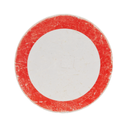</a> <b><a href="Sign001">Sign 001</a></b> by ambientCG · <a href="https://ambientcg.com/a/Sign001">source</a> | <a href="Sign002">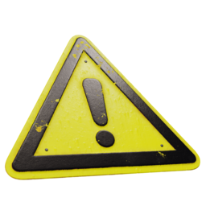</a> <b><a href="Sign002">Sign 002</a></b> by ambientCG · <a href="https://ambientcg.com/a/Sign002">source</a> |  <b><a href="Sign003">Sign 003</a></b> by ambientCG · <a href="https://ambientcg.com/a/Sign003">source</a> | <a href="Sign004">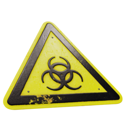</a> <b><a href="Sign004">Sign 004</a></b> by ambientCG · <a href="https://ambientcg.com/a/Sign004">source</a> |
| <a href="Sign005">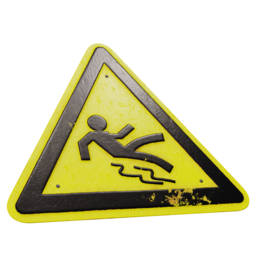</a> <b><a href="Sign005">Sign 005</a></b> by ambientCG · <a href="https://ambientcg.com/a/Sign005">source</a> |  <b><a href="Sign006">Sign 006</a></b> by ambientCG · <a href="https://ambientcg.com/a/Sign006">source</a> | <a href="Sign007">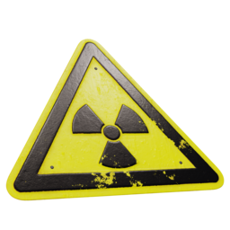</a> <b><a href="Sign007">Sign 007</a></b> by ambientCG · <a href="https://ambientcg.com/a/Sign007">source</a> | <a href="Sign008">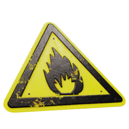</a> <b><a href="Sign008">Sign 008</a></b> by ambientCG · <a href="https://ambientcg.com/a/Sign008">source</a> |
| <a href="Sign009">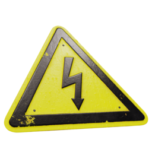</a> <b><a href="Sign009">Sign 009</a></b> by ambientCG · <a href="https://ambientcg.com/a/Sign009">source</a> | <a href="Sign010">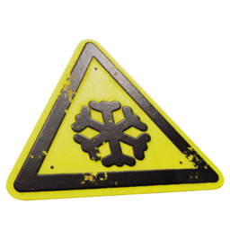</a> <b><a href="Sign010">Sign 010</a></b> by ambientCG · <a href="https://ambientcg.com/a/Sign010">source</a> | <a href="Sign011">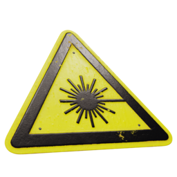</a> <b><a href="Sign011">Sign 011</a></b> by ambientCG · <a href="https://ambientcg.com/a/Sign011">source</a> | <a href="Sign012">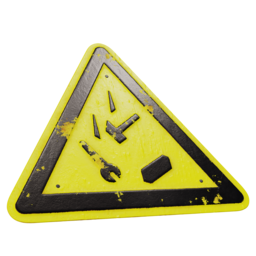</a> <b><a href="Sign012">Sign 012</a></b> by ambientCG · <a href="https://ambientcg.com/a/Sign012">source</a> |
| <a href="Sign013">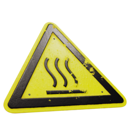</a> <b><a href="Sign013">Sign 013</a></b> by ambientCG · <a href="https://ambientcg.com/a/Sign013">source</a> | <a href="Sign014">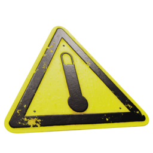</a> <b><a href="Sign014">Sign 014</a></b> by ambientCG · <a href="https://ambientcg.com/a/Sign014">source</a> | <a href="Sign015">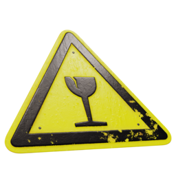</a> <b><a href="Sign015">Sign 015</a></b> by ambientCG · <a href="https://ambientcg.com/a/Sign015">source</a> | <a href="Sign016">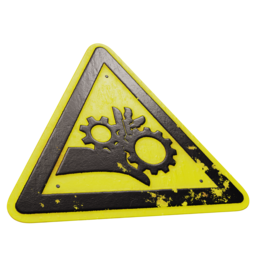</a> <b><a href="Sign016">Sign 016</a></b> by ambientCG · <a href="https://ambientcg.com/a/Sign016">source</a> |
| <a href="Sign017">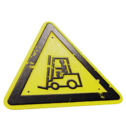</a> <b><a href="Sign017">Sign 017</a></b> by ambientCG · <a href="https://ambientcg.com/a/Sign017">source</a> | <a href="Sign018">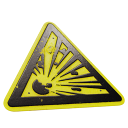</a> <b><a href="Sign018">Sign 018</a></b> by ambientCG · <a href="https://ambientcg.com/a/Sign018">source</a> | <a href="Sign019">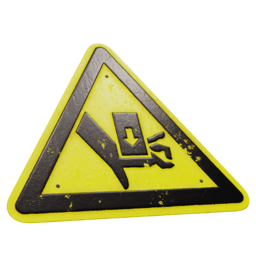</a> <b><a href="Sign019">Sign 019</a></b> by ambientCG · <a href="https://ambientcg.com/a/Sign019">source</a> | <a href="Sign020">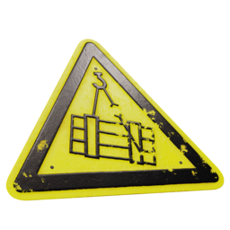</a> <b><a href="Sign020">Sign 020</a></b> by ambientCG · <a href="https://ambientcg.com/a/Sign020">source</a> |
| <a href="Sign021">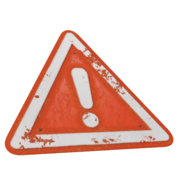</a> <b><a href="Sign021">Sign 021</a></b> by ambientCG · <a href="https://ambientcg.com/a/Sign021">source</a> | <a href="Sign022">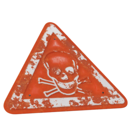</a> <b><a href="Sign022">Sign 022</a></b> by ambientCG · <a href="https://ambientcg.com/a/Sign022">source</a> | <a href="Sign023">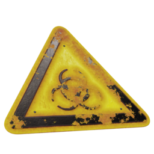</a> <b><a href="Sign023">Sign 023</a></b> by ambientCG · <a href="https://ambientcg.com/a/Sign023">source</a> | <a href="Sign024">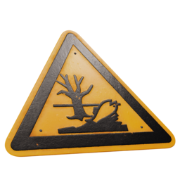</a> <b><a href="Sign024">Sign 024</a></b> by ambientCG · <a href="https://ambientcg.com/a/Sign024">source</a> |
|  <b><a href="Sign025">Sign 025</a></b> by ambientCG · <a href="https://ambientcg.com/a/Sign025">source</a> | <a href="Sign026">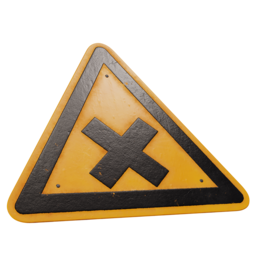</a> <b><a href="Sign026">Sign 026</a></b> by ambientCG · <a href="https://ambientcg.com/a/Sign026">source</a> |  |  |

---

Kept up to date by this repository's own [update workflow](.github/workflows/update.yml), with code and plan from [cc0-mirror](https://github.com/zuujis-cc0/cc0-mirror). Something wrong? [Open an issue there](https://github.com/zuujis-cc0/cc0-mirror/issues/new) or use the [private report form](https://games.zuujis.com/report).
